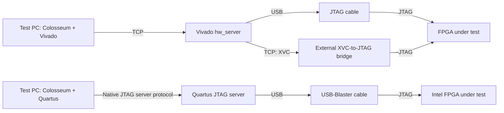

# JTAG

Requires Equipment 0.22 for Vivado or 0.23 for Quartus, an installed
vendor toolchain, and supported programming hardware. The verification examples also use Shared. Use the port
labels on the board to identify TCK, TMS, TDI, TDO, reference voltage and ground.

Choose the path for your toolchain and cable. The hardware server can run on
the test PC or on a separate host. Programming and scan examples share the
chosen connection.

| Reference | What it does |
| --- | --- |
| [test_idcode.py](test_idcode.py) | Compare IDCODEs in backend discovery order |
| [test_ir_dr_shift.py](test_ir_dr_shift.py) | Compare captured TDO to board-specific expectations |
| [programming.py](programming.py) | Select direct programming, flash program, verify, boot or custom Tcl |

Copy the topic, fill the settings and config, then run
`colosseum run test_idcode.py --config config.toml`.
Use list_targets and list_devices to obtain exact selectors for your board.
For raw scans supply the complete chain IR/DR widths, order and vectors.
Use instructions that are documented and appropriate for your fixture.

For programming, match the image and flash part to the device and use the
appropriate boot straps. Flash images are prebuilt. Set SETTINGS to the keyword
arguments for the selected operation, such as image and flash_part for flash.
For Zynq or Versal boot, supply reset and check_boot Python functions in SETTINGS.
The custom Tcl example sources the adjacent inspect_target.tcl file.

## Quartus references

Copy the [Quartus bench configuration](config.quartus.toml.example), then set
the tool path, exact cable name, and device selector. Omit the remote server
fields when using a local cable. For a remote cable, set the password
environment variable and call `col.equipment.jtag.register_server(jtag_id=1,
key="register")` once before discovering and selecting the target.

Reuse [test_idcode.py](test_idcode.py) for chain inventory. Use
[quartus_device_scan.py](quartus_device_scan.py) to check device-scoped IR/DR
captures. The [programming example](programming.py) accepts SOF files for
direct configuration, JIC files for flash, and board callbacks for boot.
For Quartus custom Tcl, set SETTINGS to a script keyword argument pointing
to your local Quartus Tcl file.
