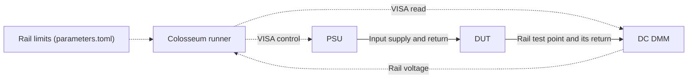
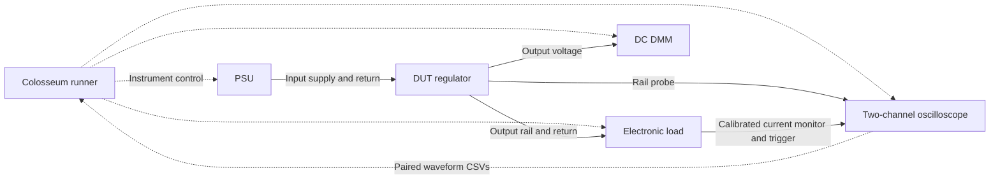
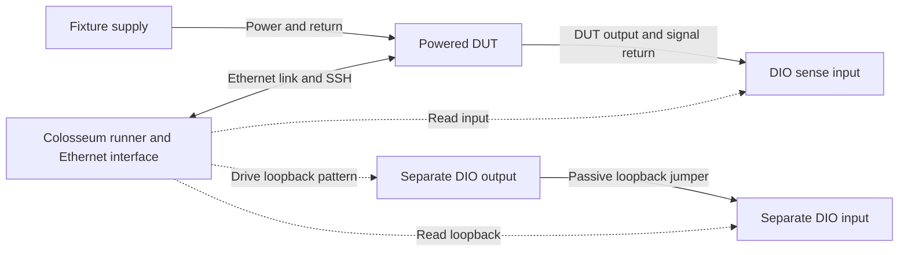
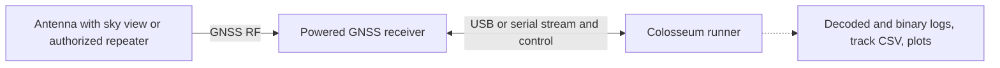
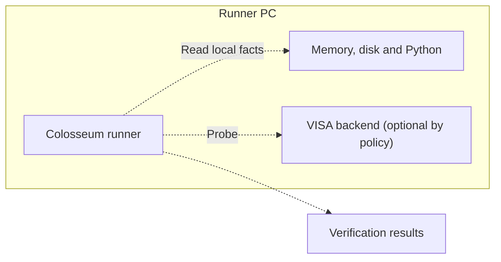
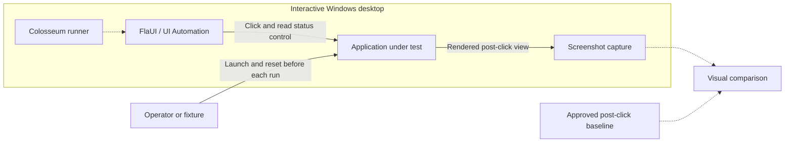

# Recommended test setups

Use the linked suite template and topic instructions to fill instrument IDs,
limits and fixture settings. Solid arrows show physical or application paths.
Dotted arrows show runner control, configuration, or evidence. These diagrams
show live setups. See [simulation and live bench setup](bench_modes.md) before
selecting drivers.

## Power acceptance

The block owns the PSU output and switches it off in cleanup. Prepare the DUT
enable state and provide its allowed startup time.

[Suite template](../suites/power_acceptance.toml.example) · [Rail voltage procedure](../power/rail_voltage/)

## Dynamic power

Each block cycles and releases its own PSU and load. The current monitor must
measure the physical load current. Deskew the rail and current channels and
configure the current monitor as the scope trigger.

[Suite template](../suites/power_dynamic.toml.example) · [Loaded-rail procedure](../power/eload/) · [Transient procedures](../power/transient/)

## Digital bring-up

The fixture owns DUT power and firmware setup. The DIO line wired to the DUT
output stays input-only. The loopback uses two other pins. The DUT-command tests
run the configured SSH release command during cleanup.

[Suite template](../suites/digital_bringup.toml.example) · [GPIO procedures](../digital/gpio/) · [Ethernet link procedure](../digital/ethernet/)

## GNSS receiver

The fixture provides usable sky signal and receiver power. Each block sets the
receiver message profile and stops its own recording. The suite measures
time-to-fix from a marked acquisition start on an already operating receiver.

[Suite template](../suites/gnss_receiver.toml.example) · [GNSS procedures](../rf/gnss_receiver/)

## Host smoke

The suite reads host facts and can require a real VISA backend. Instrument
connectivity and calibration are separate fixture checks.

[Suite template](../suites/host_smoke.toml.example) · [Bench prerequisites](../host/bench_prerequisites/)

## Desktop smoke

Both blocks use the same desktop configuration. Keep that session interactive
and preserve the post-click application state until the comparison completes.

[Suite template](../suites/gui_desktop_smoke.toml.example) · [UIA click](../gui/desktop/uia_click/) · [Screenshot comparison](../gui/desktop/screenshot_match/)
